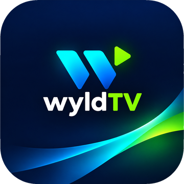
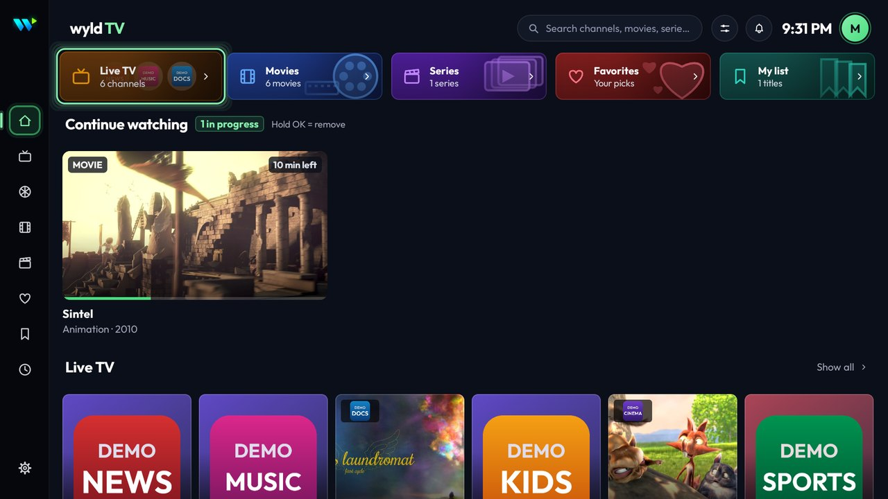
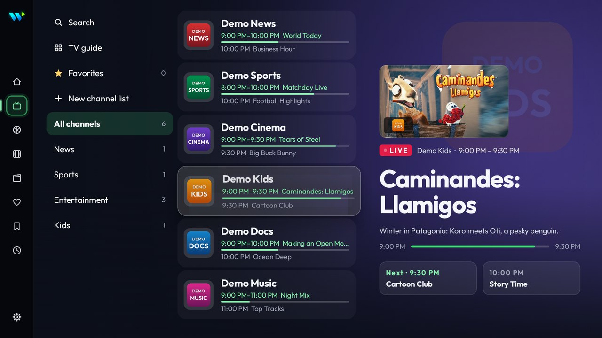
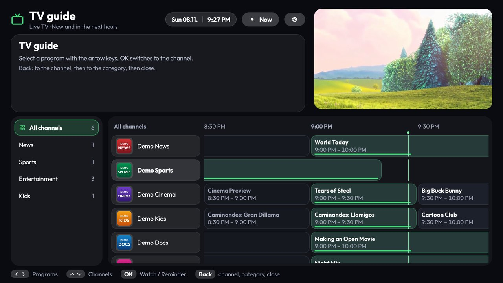
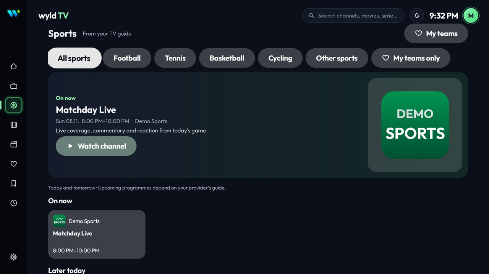
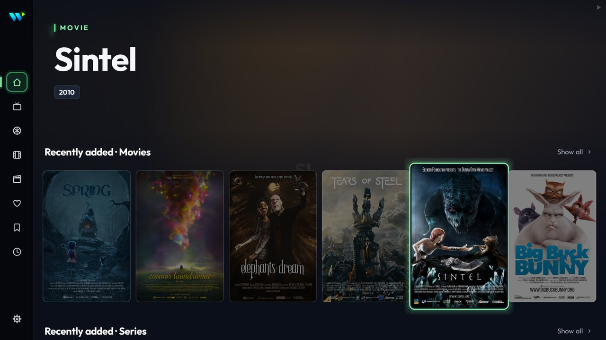
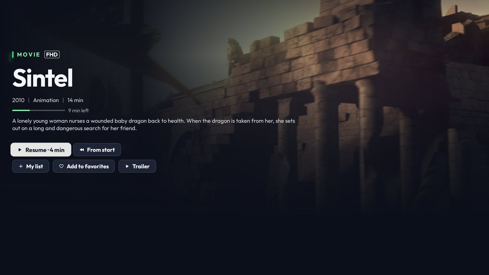
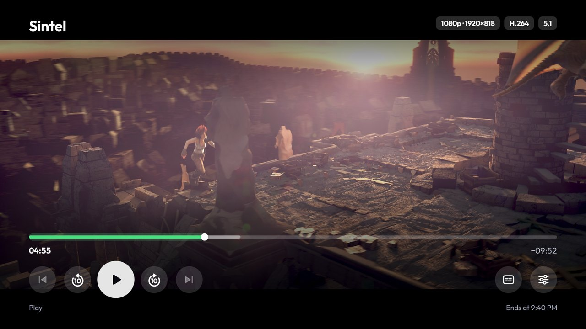
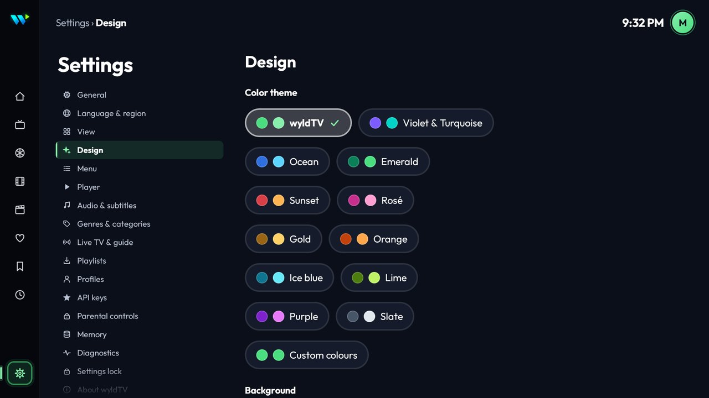
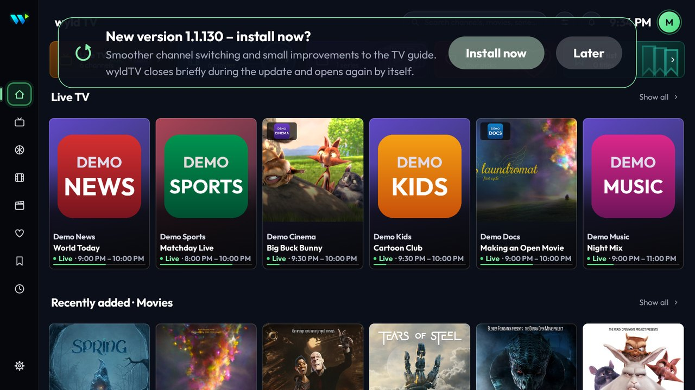

# wyldTV

**wyldTV is a TV app for watching your own IPTV playlist on Android TV, Google TV and Amazon Fire TV.** It is built for the remote control: big tiles, a clear TV guide and a player that stays out of the way.

wyldTV is only a player. **It brings no content**: no channels, playlists, films or series. You add your own playlist (an Xtream Codes login or an M3U address) from a provider you are allowed to use. wyldTV is a small private, non-commercial project for friends and family; it is not sold and has no ads.

## What it can do

- **Your playlist, quickly set up.** Xtream Codes login or M3U address, several playlists, typing from your phone over Wi-Fi. Very large playlists load fine, and the playlist refreshes itself in the background.
- **Home screen.** Continue watching, live TV now, new and top rated titles, my list and favourites at a glance.
- **Live TV.** Channel lists, favourites and your own lists, the programme on now and next, a full TV guide, catch-up ("from the beginning") where your provider offers it, and reminders.
- **Sports.** Sports on now and coming up today and tomorrow, taken from your provider's TV guide, with "My teams".
- **Films and series.** Browse by category, genre, year or rating, search with typo tolerance, detail pages with resume, my list and favourites; seasons and episodes for series.
- **A good player.** Audio and subtitle choice, surround sound (also over Bluetooth headphones), skip intro and credits, next episode automatically, quality choice and automatic recovery when the stream drops.
- **For the whole family.** Profiles ("Who's watching?"), parental controls with a PIN, history, backup and restore of settings.
- **Your look.** A dozen colour themes or your own colours, adjustable text size, and 9 languages: English, German, Turkish, Bosnian, Croatian, Serbian, Spanish, French and Italian.
- **Updates itself.** The app checks for a new version about once a day and offers to install it.

Optional extras need your own free keys (entered in the app under *Settings > API keys*): TMDB for posters, descriptions and cast, OMDb for IMDb and Rotten Tomatoes ratings. Without keys, wyldTV uses what your provider supplies.

## Screenshots

| | |
|---|---|
|  **Home**: continue watching, live TV now |  **Live TV**: channels with now and next |
|  **TV guide**: timeline with a live preview |  **Sports**: what's on now and later today |
|  **Films**: browse your playlist's films |  **Film details**: resume, my list, favourites |
|  **Player**: simple controls for the remote |  **Settings**: grouped, remote-friendly |
|  **Updates**: a new version is offered on the TV | |

The screenshots show demo content only: openly licensed Blender films (see [Credits](#credits)) and made-up demo channels. The update card was captured on a test build with a demo version number.

## Install on a TV (first time)

1. On the TV, install the free **Downloader** app (by AFTVnews) from the TV's app store.
2. Allow Downloader to install apps: TV settings → *Apps* (Fire TV: *My Fire TV* → *Developer options*) → *Install unknown apps* → *Downloader* → on.
3. Open Downloader and enter this address, which always gives the newest version:

   `https://github.com/saschca/wyldTV-releases/releases/latest/download/wyldtv.apk`

4. Choose **Install**, then **Open**. Add your playlist in the app. (On Google TV, Play Protect may stop this first installation with "App blocked to protect your device": choose **More details**, then **Install anyway**.)

If the TV already has a wyldTV that was not installed from here, Android refuses the installation ("App not installed"). Uninstall the old one first (one time only; the playlist must then be entered again). After that, updates keep your setup.

## Updates

After the first installation, **updates arrive automatically**: the app checks for a new version about once a day, downloads it and shows a card: **"New version … – install now?"** with **Install now** and **Later**. Your playlist, logins and settings stay.

- **On Google TV** (and other devices with Google Play Protect), Google stops each update once: *"App blocked to protect your device."* Choose **More details**, then **Install anyway**. Nothing installs without this click.
- **The first time**, Android may ask to allow **"Install unknown apps"** for wyldTV. The card opens that list: choose **wyldTV**, allow it, go back and press **Install now** again.
- wyldTV closes during the install. It reopens by itself if "Display over other apps" is allowed for it; otherwise open it again afterwards.

## What a release contains

Each [release](https://github.com/saschca/wyldTV-releases/releases) contains:

- `wyldtv-<version>.apk`: the app (also as `wyldtv.apk`, the same file under a fixed name for the first installation);
- `update.json`: what installed apps read to find out about a new version;
- `wyldtv-<version>-source.tar.gz`: the matching source code.

There is no source tree in this repository, and it does not take issues or pull requests.

## Source code and licence

wyldTV is free software under the **GNU General Public License version 3** (it is based on IPVIO Stream and includes the GPL-3.0 FFmpeg audio decoder). The complete corresponding source code of every version is attached to its release as `wyldtv-<version>-source.tar.gz`; the licence text is in the archive (`LICENSE`, `THIRD_PARTY_NOTICES.md`).

## Credits

wyldTV stands on the work of many others. Thank you!

**Based on IPVIO Stream** by Emrodev, an open-source IPTV player for Android TV (GPL-3.0). wyldTV is an extensively reworked and extended version of IPVIO Stream (2026), with its own name and logo, as the original asks.

**Libraries**

| Component | Licence |
|---|---|
| AndroidX (Activity, Compose UI/Foundation, Work) | Apache License 2.0 |
| AndroidX Media3 (ExoPlayer, HLS, UI) | Apache License 2.0 |
| Jellyfin Media3 FFmpeg decoder (contains FFmpeg) | GNU GPL v3 |
| OkHttp (Square) | Apache License 2.0 |
| Coil | Apache License 2.0 |
| Kotlin standard library and coroutines (JetBrains) | Apache License 2.0 |
| JUnit 4 (tests only) | Eclipse Public License 1.0 |

**Fonts**: Outfit (The Outfit Project Authors) and Inter (The Inter Project Authors), both under the SIL Open Font License 1.1.

**Online services** (optional)

| Service | Used for |
|---|---|
| [The Movie Database (TMDB)](https://www.themoviedb.org/) | film and series information and images, with your own free key |
| [OMDb API](https://www.omdbapi.com/) | IMDb and Rotten Tomatoes ratings, with your own free key |
| [TheIntroDB](https://theintrodb.org/) | intro, recap and credits times, no key needed |
| [tv-logo/tv-logos](https://github.com/tv-logo/tv-logos) | sharp channel logos, no key needed |

*This product uses the TMDB API but is not endorsed or certified by TMDB.*

Sharp channel logos come from the [tv-logos](https://github.com/tv-logo/tv-logos) project. The logos are trademarks of their owners, shared there under Creative Commons ShareAlike licences for personal use; wyldTV links to them for private, non-commercial use and does not bundle them.

**Demo content in the screenshots**: open movies by the Blender Foundation | [studio.blender.org](https://studio.blender.org/). The screenshots show the following works, scaled down and partly cropped inside the app's screens. Each is used under the Creative Commons licence given on its Wikimedia Commons file page:

| Shown | Author | Licence | Source |
|---|---|---|---|
| Sintel (2010): frames from the film (home, film details, player) | Blender Foundation, Durian Open Movie project | [CC BY 3.0](https://creativecommons.org/licenses/by/3.0/) | [Wikimedia Commons](https://commons.wikimedia.org/wiki/File:Sintel_movie_4K.webm) |
| Big Buck Bunny (2008): the film in the TV guide preview | Blender Foundation | [CC BY 3.0](https://creativecommons.org/licenses/by/3.0/) | [Wikimedia Commons](https://commons.wikimedia.org/wiki/File:Big_Buck_Bunny_4K.webm) |
| Big Buck Bunny: poster | Blender Foundation | [CC BY 3.0](https://creativecommons.org/licenses/by/3.0/) | [Wikimedia Commons](https://commons.wikimedia.org/wiki/File:Big_buck_bunny_poster_big.jpg) |
| Big Buck Bunny: still on the live TV cards | Blender Foundation | [CC BY 3.0](https://creativecommons.org/licenses/by/3.0/) | [Wikimedia Commons](https://commons.wikimedia.org/wiki/File:Big.Buck.Bunny.-.Frank.Rinky.Gimera.png) |
| Sintel: poster | Blender Foundation | [CC BY 3.0](https://creativecommons.org/licenses/by/3.0/) | [Wikimedia Commons](https://commons.wikimedia.org/wiki/File:Sintel_poster.jpg) |
| Tears of Steel (2012): poster | Blender Foundation, Project Mango | [CC BY 3.0](https://creativecommons.org/licenses/by/3.0/) | [Wikimedia Commons](https://commons.wikimedia.org/wiki/File:Tos-poster.png) |
| Elephants Dream (2006): poster | Bassam Kurdali, Andy Goralczyk and the Blender Foundation | [CC BY 4.0](https://creativecommons.org/licenses/by/4.0/) | [Wikimedia Commons](https://commons.wikimedia.org/wiki/File:ElephantsDreamPoster.jpg) |
| Cosmos Laundromat (2015): poster | Andy Goralczyk and the Blender Foundation | [CC BY 4.0](https://creativecommons.org/licenses/by/4.0/) | [Wikimedia Commons](https://commons.wikimedia.org/wiki/File:CosmosLaundromatPoster.jpg) |
| Cosmos Laundromat: still on the live TV cards | Blender Foundation, Gooseberry project | [CC BY 3.0](https://creativecommons.org/licenses/by/3.0/) | [Wikimedia Commons](https://commons.wikimedia.org/wiki/File:CosmosLaundromatYouTubeThumbnail.jpg) |
| Spring (2019): poster | Francesco Siddi | [CC BY 4.0](https://creativecommons.org/licenses/by/4.0/) | [Wikimedia Commons](https://commons.wikimedia.org/wiki/File:Spring2019PillarPosterBlender.jpg) |
| Caminandes 3: Llamigos (2016): cover picture | Blender Foundation | [CC BY 4.0](https://creativecommons.org/licenses/by/4.0/) | [Wikimedia Commons](https://commons.wikimedia.org/wiki/File:Blender_Foundation_-_Caminandes_-_Episode_3_-_Llamigos_-_Cover_thumbnail.png) |

The "Demo News", "Demo Sports" and other demo channels, their logos and their programme titles were made up for the screenshots.

## Trademarks

IMDb, Rotten Tomatoes, TMDB, Android TV, Google TV, Google Play Protect, Fire TV and Blender are trademarks of their respective owners; channel logos are trademarks of their owners. wyldTV is not affiliated with or endorsed by any of them.

## For the maintainer

The **Release** workflow (Actions → Release → Run workflow) builds, signs and publishes a new version. It is a copy of `release/release.yml` from the private source repository, where it is reviewed; change it there first. This README and its `screenshots/` folder come from `release/` in the same repository and are copied here the same way. The procedure is described in `docs/RELEASING.md` of the source repository.
